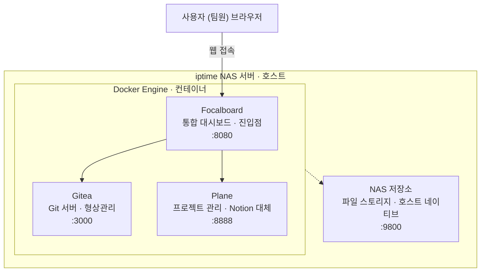

# 오픈소스 기반 팀 협업 인프라 구축·운영

프로젝트: 재조합 (블루이글루) 게임 개발 · 인디 게임 개발 · 2026.03 ~ 현재 (NAS 2026.03~07, 데스크톱 서버 2026.08~)

## 개요

iptime NAS 서버 위에 Docker 컨테이너로 Gitea·Plane을 구동하고, Focalboard로 팀 대시보드를 만들었습니다. 팀원은 대시보드에서 각 서비스로 들어갑니다.

## 상세 설명

iptime NAS의 Docker 환경에 각 서비스를 독립 컨테이너로 배포했습니다.

- Focalboard (`:8080`): 팀 진입점 대시보드
- Gitea (`:3000`): 형상관리
- Plane (`:8888`): 프로젝트·이슈 트래킹
- NAS 자체 파일 스토리지 (`:9800`): 리소스 백업 및 대용량 에셋 공유

팀원은 URL로 접속합니다.

## 서버 이전 (2026.08)

2026-07-25에 NAS의 Gitea 포트가 응답하지 않았습니다. 재부팅, IP 변경, 디스크 용량은 아니었고, 약 10GB짜리 비-LFS 리소스 저장소를 Unity 패키지 매니저가 풀 클론하면서 NAS 메모리(3.7GB)가 바닥난 것이 원인이었습니다. git 메모리 상한과 정기 점검 중단으로 증상을 잡았지만, 이후 NAS 데이터가 모두 소실되어 Windows 11 데스크톱(WSL2 Ubuntu, Docker)으로 옮겼습니다.

새 서버는 Gitea(3000), Plane(8080), 빌드 러너를 Tailscale 안에서만 열고 포트포워딩을 쓰지 않습니다. 팀원에게는 노드 공유와 ACL로 3개 포트만 허용했습니다. restic 백업(04:30)과 05:00 재부팅을 작업 스케줄러로 돌리며, 저장소 크기 상한(receive.maxInputSize)과 LFS 강제, 컨테이너 메모리 제한을 처음부터 넣었습니다.

## NAS 시절 아키텍처

## 스크린샷

---
[포트폴리오로 돌아가기](https://jjh0204.github.io/JJH0204/)
