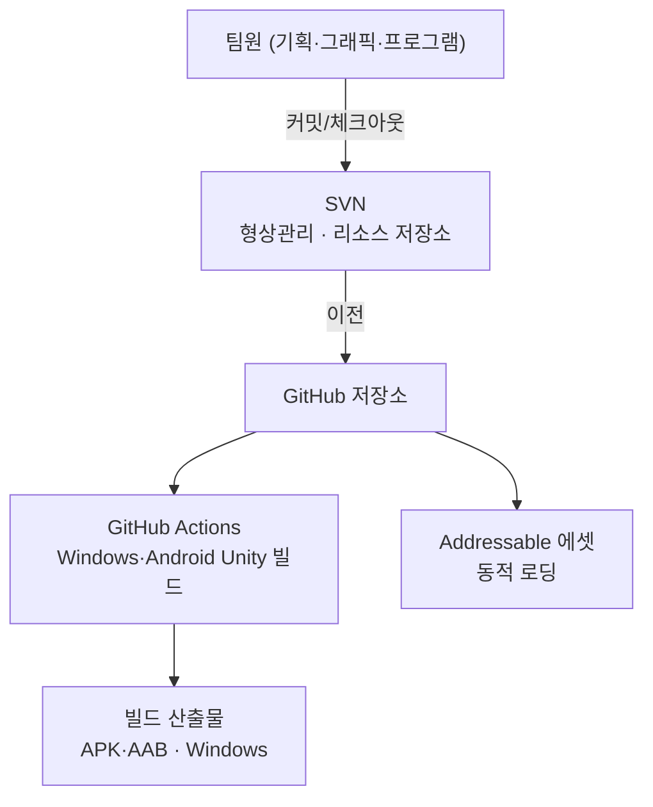

# 협업·빌드 인프라 구축

프로젝트: Phantom:Makina (TPS 슈팅 게임) · 팀 프로젝트 · 2025.06 ~ 2026.09

역할: 기획·개발 참여 (팀: 기획 1, 원화 2, 3D 모델러 3, 프로그래머 2)

## 개요

SVN으로 형상관리·리소스 공유 프로세스를 표준화했고, GitHub로 옮긴 뒤 Unity 빌드 워크플로와 안드로이드 빌드를 구성했습니다.

## 상세 설명

초기에는 SVN 저장소를 팀 전체의 형상관리 허브로 사용했습니다. 이후 GitHub로 옮긴 뒤(본인 커밋은 2025년 12월부터) Addressable 에셋 설정과 안드로이드 빌드 설정을 정리하고, Windows·Android용 Unity 빌드 워크플로(GitHub Actions)를 작성했습니다(2026년 2월). 안드로이드 APK·AAB 빌드는 2026년 1월부터 5월까지 11개를 만들었습니다. 팀 저장소 본인 커밋은 25Machina 62/252, 2025_Project_ProjectRecombination 56/281이며 최다 커밋자는 다른 팀원입니다.

## SVN을 쓴 이유

초기에는 Git 도입을 검토했지만, 팀 구성원의 학습 곡선을 고려해 SVN으로 방향을 바꿨습니다. 팀에는 Git 사용 경험이 없는 디자이너가 있었고, PD 역할을 겸한 학원 강사님도 Git으로 협업해본 경험이 없었습니다. 개발 기간이 정해진 팀 프로젝트에서 형상관리 도구 학습에 시간을 쓰기보다, 구성원 전체가 빠르게 익혀 실제 협업에 곧바로 활용할 수 있는 도구가 우선이라고 판단했습니다.

이에 따라 브랜치·스테이징 같은 개념 없이 직관적인 단일 저장소 구조로 동작하는 SVN을 선택했고, 팀 전체가 도구에 막히지 않고 형상관리·리소스 공유 프로세스에 빠르게 적응할 수 있었습니다.

## 아키텍처

## 프로그래머로서의 기여

빌드 작업과 별도로, 몬스터 AI와 팀 공용 개발 도구를 만들었습니다.

### 몬스터 AI: Behavior Tree 시스템 자체 구현

Unity 내장 기능에 의존하지 않고 Behavior Tree 기반 AI 시스템을 직접 설계·구현했습니다.

- 트리 구조로 몬스터·NPC의 행동을 설계하고, Composite(Selector·Sequence)·Decorator·Leaf 노드로 조건 분기와 행동을 정의
- 런타임에서 트리를 평가·실행하며, 순환 평가(cyclic evaluation)를 방지하도록 노드 구조를 리팩터링
- 보스 페이즈 상태(phase state)와 동적 상태 전환(state management)까지 확장
- 트리를 직접 만들 수 있는 GraphView 기반 그래프 뷰 에디터를 함께 구현: 드래그 앤 드롭으로 노드를 연결·배치하고 트리 구조를 저장/불러오기
- 레포: [github.com/JJH0204/MonsterAI](https://github.com/JJH0204/MonsterAI)

### 팀 공용 개발 도구 제작

- GOS (Game Object Scripting): 게임 오브젝트를 조합해 코드 없이 기믹을 구현하는 비주얼 스크립팅 플러그인. 트리거·타이머·조건/논리·오브젝트 활성화·시네머신 컷씬 등 입력→처리→출력 노드를 제공해, 기획·비프로그래머도 기믹을 직접 구성할 수 있도록 지원. 레포: [github.com/JJH0204/GOS](https://github.com/JJH0204/GOS)
- UnityPriorityQueue: 몬스터 AI 등에서 사용할 우선순위 큐 자료구조를 구현해 재사용 가능한 형태로 분리. 레포: [github.com/JJH0204/UnityPriorityQueue](https://github.com/JJH0204/UnityPriorityQueue)

### 트러블슈팅: 공유한 BT 시스템 오류 대응

팀(8K)에 공유한 Behavior Tree 시스템에서 발생한 오류를 별도 리포지토리로 복제·재현해 원인을 분석하고 해결했습니다. 공용 코드를 배포한 뒤 발생한 문제를 격리된 환경에서 재현·수정하는 대응 경험입니다. 레포: [github.com/JJH0204/8K_BT_Error](https://github.com/JJH0204/8K_BT_Error)

## 관련 레포지토리

- 팀 프로젝트(Phantom:Makina) 백업: [github.com/shion0202/2025_Project_ProjectRecombination](https://github.com/shion0202/2025_Project_ProjectRecombination)

---
[포트폴리오로 돌아가기](https://jjh0204.github.io/JJH0204/)
